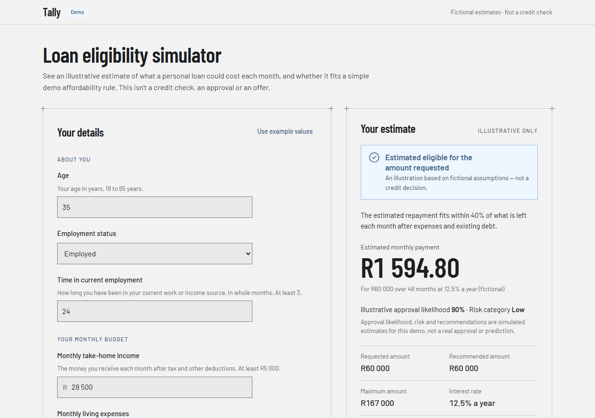
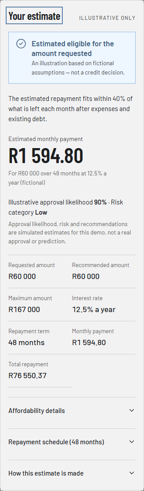

# Loan eligibility simulator (Tally — demo)

A responsive, client-only web app. A customer enters their monthly take-home income, living expenses and existing debt repayments, plus a loan amount and term, and sees an **illustrative** estimated monthly repayment and whether it fits a simple **fictional** affordability rule, with an explanation and suggestions.

**Live demo: [tally-loan-simulator.onrender.com](https://tally-loan-simulator.onrender.com)** (free Render static hosting).

Built for a Front-End Software Engineer recruitment assignment. "Tally" is a fictional product name; the app is not affiliated with any bank or lender.

> **Fictional data.** Every rate, fee, limit and rule here (19.5% a year, a R69 monthly fee, a 40% affordability limit) is made up for demonstration. This is not a credit check, an approval, an offer, or any lender's or regulator's assessment. The app runs entirely in the browser: it stores nothing and sends nothing anywhere.





## Quick start

Requires **Node.js 24** (tested with 24.18.0; the `.nvmrc` default) or **22.22.2 or later on the 22 line** (checked in CI), and npm 10 or later.

```sh
npm ci              # install exactly what package-lock.json specifies
npm run dev         # development server: http://localhost:5173
```

To run the production build locally:

```sh
npm run build       # type-checks, then writes the static site to dist/
npm run preview     # serves dist/ at http://localhost:4173
```

## Docker

```sh
docker build -t loan-eligibility-simulator .
docker run --rm -p 8080:8080 loan-eligibility-simulator
# open http://localhost:8080
```

The image builds the app with Node, then serves only the static files from unprivileged nginx (non-root, uid 101, port **8080**). `index.html` is sent with `Cache-Control: no-cache`, so a new deploy shows up immediately, and content-hashed files under `/assets/` are cached for a year as `immutable`. Every response carries a strict Content Security Policy (`'self'` only) and standard security headers. Unknown paths return 404, because the app has no client-side routes.

## Tests

```sh
npm run check           # typecheck + lint + format check + unit tests + build: the main gate
npm test                # unit and component tests (Vitest), run once
npm run test:watch      # the same, re-running on change
npm run test:coverage   # unit tests with a coverage report in coverage/
npm run test:e2e        # browser tests (Playwright) against the production build
npm run test:a11y       # only the axe accessibility checks
```

The browser tests need Playwright's browsers once:

```sh
npx playwright install chromium firefox webkit                # Windows and macOS
npx playwright install --with-deps chromium firefox webkit    # Linux: also installs system libraries
```

`npm run test:e2e` builds the app and serves it itself. To run the same suite against something already running, such as the Docker container:

```sh
E2E_BASE_URL=http://127.0.0.1:8080 npm run test:e2e           # bash, zsh
```

```powershell
$env:E2E_BASE_URL = "http://127.0.0.1:8080"; npm run test:e2e; Remove-Item Env:E2E_BASE_URL   # PowerShell
```

What runs: 208 unit and component tests, with 100% coverage enforced by `test:coverage` for the pricing model, the form reducer and the expense helper's state, and 121 browser test runs (117 run and 4 skipped by design, because they apply to one engine or width). Chromium runs everything: layout, interactions, results and axe checks at 1280, 360 and 320 px. Firefox and WebKit run the core flows. CI runs all of this on every push, then runs the browser suite a second time against the built Docker image.

## How it works

```
src/
  app/App.tsx                    page: header, intro, simulator, footer
  components/                    shared presentational pieces (SiteHeader, SiteFooter, Button, FrameCorners)
  features/loan-simulator/
    LoanSimulator.tsx            the two-column layout; owns the form state; moves focus after Calculate
    formState.ts                 pure reducer: edits, blur, submit, the last result and its freshness
    LoanForm.tsx, ResultsPanel.tsx and their parts
    model/                       pure functions, no React: parsing, validation, calculation, formatting, wording
  styles/                        design tokens and global CSS
e2e/                             Playwright browser tests
nginx/, Dockerfile               runtime server, headers and caching
```

- **Pure model, thin UI.** Parsing, validation, the calculation and all result wording are plain TypeScript in `model/`, unit-tested without React. Components only render what the model returns.
- **Editing versus calculating.** Fields keep exactly what was typed and are tidied only when you leave them (`28500` → `28 500`). Empty and malformed text is never turned into zero. Calculate validates everything at once, with a linked error summary and inline errors.
- **One snapshot per result.** Every figure on screen comes from the last successful calculation. Change an input and the estimate stays visible but is marked out of date; change it back and it is current again. Formatting alone never counts as a change.
- **Optional expense helper.** "Help me calculate my expenses", under the expenses field, breaks living costs into 8 categories (blank counts as R0) and shows a running total. It is only a draft: the expenses field changes only when you select **Use this total**, and the calculation always reads that one field. An unchanged total leaves an estimate current; a different total marks it out of date. Opening the helper keeps whatever is already in the field, and Cancel discards the draft.

### The fictional model

| Assumption    | Value                                                                                                  |
| ------------- | ------------------------------------------------------------------------------------------------------ |
| Interest      | 19.5% a year, fixed, compounded monthly (r = 0.195 ÷ 12)                                               |
| Fee           | R69 added to every monthly repayment; no initiation fee                                                |
| Affordability | the repayment may use up to 40% of income minus living expenses and existing debt                      |
| Limits        | income R1 000 – R1 000 000; expenses and debt R0 – R1 000 000; loan R1 000 – R250 000; 12 to 60 months |

```
available  = income − expenses − debt
repayment  = round_half_up( loan × r ÷ (1 − (1 + r)^−months) ) + R69     (to the cent)
outcome    = "no room"  if available ≤ 0
             "within"   if 5 × repayment ≤ 2 × available                  (exactly 40%, in integers)
             "above"    otherwise
remaining  = available − repayment          (shown as a negative when commitments exceed income)
total      = repayment × months             (fees included)
```

All money is integer cents. The only floating-point step is the amortisation factor, rounded once to the cent; the 40% test is an exact integer comparison, so no boundary depends on floating-point error. The eight reference cases in [SIMULATION_MODEL.md](docs/SIMULATION_MODEL.md) were checked independently with 50-digit decimal arithmetic and are unit tests.

### Key decisions and trade-offs

- **Client-only, no backend.** The brief asks for estimates from mocked assumptions, so there is nothing to keep server-side, and no personal financial data ever leaves the browser.
- **React 19, Vite, strict TypeScript, CSS Modules with design tokens**, and no component library: native, labelled form controls are enough and are easier to make accessible.
- **Accessibility fixes over pixel fidelity** where the design fell short: darker filled buttons (contrast), visible field borders, rem-based text that follows the browser's text size, and system colours in Windows high-contrast mode.
- **Proportionate browser coverage:** the full suite in Chromium at three widths, core flows in Firefox and WebKit, rather than every test in every engine.

Every decision, with its reason and source, is in [DECISIONS.md](docs/DECISIONS.md).

## Accessibility

Targeting WCAG 2.2 AA. Automated axe checks pass for every tested state at three widths. Keyboard order and focus, contrast (measured), emulated 200% and 400% zoom, text spacing, larger browser text, forced colours, reduced motion and target sizes were reviewed and fixed where needed. See the [accessibility review](docs/validation/phase-3/ACCESSIBILITY_REVIEW.md).

**Still to be checked by a person:** a screen reader (NVDA or Narrator), the browser's own zoom at 200% and 400%, a real Windows high-contrast theme, and Safari or a physical phone. This is not a WCAG conformance claim.

## Hosting

The live demo at https://tally-loan-simulator.onrender.com is a free [Render](https://render.com) Static Site defined in `render.yaml`:

- **Build:** `npm ci && npm run build` on Node 24, publishing `dist/`.
- **Deploys:** only after CI passes on `main`.
- **Headers:** the same security headers and caching as the nginx container. There are no rewrite rules, so unknown paths return 404 there too.

Differences from Docker: Render's CDN serves the files and adds HTTPS (with HSTS) and Brotli, and the nginx configuration is not used; `render.yaml` reproduces its headers instead. One difference remains: Render's built-in 404 page is a plain-text "Not Found" without the security headers, which the nginx container sends on every response.

## Known limitations

- The model is deliberately simple and fictional: no credit history, credit insurance, rate changes or bureau data.
- Light theme only, as designed.
- WebKit coverage is Playwright's WebKit build, not Safari on a real iPhone or Mac.
- No licence has been chosen yet; that is the repository owner's decision. Third-party licences for the bundled code and fonts are in [`public/third-party-notices.txt`](public/third-party-notices.txt), which is also served with the app.

## How this was built

The visual design was produced in Claude Design (Anthropic) and is kept for reference in [`design/reference/`](design/reference/). The code, tests and documentation were written with Claude Code (Anthropic) under the author's direction and review; commits that include AI-written changes carry a `Co-Authored-By` trailer. Building and testing the project needs none of these tools or any account: everything required is in this repository.

## Documentation

- [Submission review](docs/validation/phase-4/SUBMISSION_REVIEW.md): final verification, production review and requirement checklist
- [Interview notes](docs/INTERVIEW_NOTES.md): the main engineering choices, briefly explained
- [Simulation model](docs/SIMULATION_MODEL.md): the fictional model, rounding rules and verified reference cases
- [Accessibility review](docs/validation/phase-3/ACCESSIBILITY_REVIEW.md): methods, findings, fixes and the manual checklist
- [Decisions](docs/DECISIONS.md): technical and product decisions, with reasons
- [Design handoff](docs/DESIGN_HANDOFF.md): what the imported design specifies, and where the build deviates
- [Project plan](docs/PROJECT_PLAN.md): the phases, their acceptance criteria and validation records
